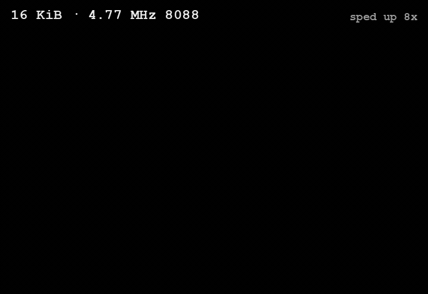
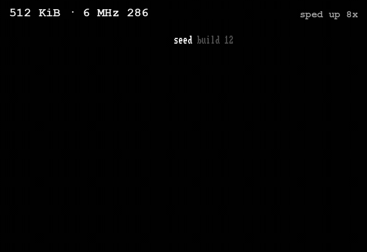

# Seed

<p align="center">
  
  
</p>

<p align="center"><sub>Earlier end-to-end agent-loop demos. The current TLS 1.3 integration described below is under validation.</sub></p>

**A frontier cloud model writes 8088 machine code, sends it to a 1981 IBM PC,
runs it there, and reads the result back into its own context.** Seed is the
boot-first real-mode runtime that makes that loop possible. One 160 KiB floppy
contains one self-selecting `SEED.SYS`, prompt/config assets, and external NIC
drivers. The same runtime starts a 4.77 MHz 8088 with 16 KiB or a 6 MHz 286
with 512 KiB, reaches OpenAI over TLS 1.3, and exposes native read, write, and
execute tools.

Seed is a small trusted control plane, not an OS or sandbox. It publishes its
memory contract and leaves the remaining machine to the user and model. A
reboot from known, preferably write-protected media is the recovery boundary.

> **Current status.** TLS 1.3 has replaced the TLS 1.2 product path on this
> work branch. Both CPU routes are integrated. The RAM-only 8088
> rearchitecture passes its current-source offline, fail-closed composition
> gates and the read-only exact-floor wire/reconnect matrix. The 286 route also
> passes its read-only exact-floor four-flow gate. Repeated provider-edge
> characterization and physical entropy-source validation remain open, so
> this is not yet an unconditional secure-floor or release claim.

## Why it is interesting

- **A real bare-metal agent loop.** OpenAI Responses streams text and native
  function calls. Seed executes `read_mem`, `write_mem`, `exec`, `save_env`,
  and `load_env`, then feeds structured results back with `store:false`.
- **TLS 1.3 at the 16 KiB floor.** A four-sector nucleus streams cold phases
  from a read-only floppy. Lifetime-separated KEM, certificate, and session
  state stays in conventional RAM below the 16 KiB ceiling; video RAM, NIC RAM,
  and writable media are not crypto storage.
- **One artifact, automatic profile selection.** Users do not choose an
  architecture-specific floppy. CPU and RAM detection select the 8088 or
  286 conforming profile inside the same `SEED.SYS`.
- **Headroom belongs to the agent.** The floor keeps a 96-byte executable
  arena and 96-byte context. At 32 KiB they are 224 bytes each; far
  conventional, EMS, HMA/native extended, and unreal-mode memory grow them.
- **Read-only and self-contained.** Private keys, entropy input, certificate
  checks, and any same-boot ticket are produced and consumed by the target.
  No trusted modern helper or writable floppy is required.

## TLS profiles

| Floor | Route | Honest claim |
| --- | --- | --- |
| 4.77 MHz 8088, 16 KiB | TLS 1.3 wire protocol, SHA-256, ChaCha20-Poly1305, genuine ML-KEM-768 contribution; fixed X25519 `u=9` | bounded Seed credential-release boundary; effective ML-KEM-only and deferred authentication, not standards-conforming hybrid TLS |
| 6 MHz 286, 512 KiB | real ML-KEM-768 + real X25519, strict WE1/leaf/time/CV authentication | fully standards-conforming TLS 1.3 `X25519MLKEM768` protocol path |

The 8088 permits only TLS handshake completion, the compiled credential-free
HEAD probe, and a bounded tentative ticket before full Fujisaki-Okamoto
validation and exact dated-leaf possession complete. The fresh connection
must authenticate both the HEAD response and ticket; a close before either
fails the attempt. After offline proof, a no-0RTT resumed connection performs
fresh KEM work, sends its HEAD only after Finished, and authenticates that
response before status-last route promotion. The API key, prompt, context,
redirects, and business request remain unreachable throughout. The ticket is
volatile, survives neither restart nor failed proof, and grants no credential
access by itself.

The 286 first authenticates a credential-free acquisition: candidate ML-KEM
plus real X25519, protected-flight/Finished verification, client Finished, the
literal HEAD, and an authenticated tentative ticket. It then completes full
FO and strict WE1/hostname/UTC/CertificateVerify checks offline. Only a
promoted same-boot ticket can enter the final no-0RTT PSK-DHE connection,
which uses independent hybrid keys, a real binder, full decapsulation, and a
strict resumed Finished before credentials become reachable. The ticket and
PSK are volatile; there is no 0-RTT, mutable leaf file, persisted ticket, or
no-time expiry bypass. Seed silently treats a coherent, valid PC/AT RTC as the
platform UTC clock; invalid or out-of-range time fails the conforming profile.

These protocol designs are implemented. Their offline composition gates,
read-only exact-floor wire/reconnect runs, authenticated dialogue, full
original-speed NIC matrix, and CGA/MDA display cases pass. Physical
entropy-source characterization and additional provider-edge repetition remain
before the validation qualifier can be removed. See
[security.md](docs/security.md) for the precise boundary and open risks.

## Try it

The product image is `build/ibm_pc_5150/floppy-160k.img` and contains **no API
key by default**.

1. Boot it in 86Box with a supported NIC. Use at least 32 KiB for direct BIOS
   floppy boot; the 16 KiB floor enters through the generated ROM BASIC
   sidecar. The conforming profile needs a 286 at 6 MHz or faster and at least
   512 KiB conventional RAM.
2. Enter an OpenAI API key when asked, or place a local `USER.CFG` under
   `SEED/` before boot. OpenAI is the only current provider route.

```text
agent openai
model <model-id>
key <scoped-openai-key>
```

Persisted credentials are plaintext. A write-protected floppy protects
recovery and immutability, not secrecy at rest. Until the physical entropy and
remaining edge-variation acceptance gates complete, use only a scoped,
rate-limited test key on this integration branch.

## System requirements

```text
8088 floor         8088-compatible, 4.77 MHz; exactly 16 KiB supported
conforming floor   286, 6 MHz; 512 KiB conventional RAM
entry               ROM BASIC sidecar below 32 KiB; direct BIOS boot at 32 KiB+
media               160 KiB 5.25-inch FAT12 image; read-only is supported
video               BIOS text mode, CGA or MDA
network             supported Ethernet adapter
provider            OpenAI / api.openai.com
emulator            86Box profiles provided for development and verification
```

Supported current NIC families include 3c501, 3c503, NE1000/NE2000, WD80x3,
PCnet/LANCE, DEC Tulip, RTL8139, and EPIC/100 across the documented machine
profiles. Inactive `.DRV` files consume no resident RAM. No-card and no-driver
machines fail through the text retry/restart path.

## Current capability

On the IBM PC target, Seed can:

- boot the same runtime through the direct or ROM BASIC entry;
- detect memory/CPU capabilities and load a suitable external NIC driver;
- obtain DHCP configuration, resolve OpenAI, and connect over TCP 443;
- dispatch to the 8088 or 286 conforming TLS 1.3 profile;
- run a streamed, multi-turn Default Prompt Interface session;
- maintain a model-compacted rolling context and RAM-scaled arena;
- execute native model tools against the published flat memory ranges; and
- save/load the user environment when writes are available, while remaining
  fully bootable from read-only media.

## Reconnect policy

Seed reuses the committed TLS session. If a human request fails before any
text appears, it retires the channel, builds exactly one fresh route,
reconstructs the same durable prompt from the screen, and sends it once more.
A second failure returns to the prompt. It never automatically replays a tool
continuation or a response after visible text, because either could duplicate
local effects.

## Known limitations

- The 16 KiB arena and context are intentionally tiny. More RAM changes the
  experience dramatically.
- The 8088 profile has an effective ML-KEM-only credential-release boundary;
  it is not conforming hybrid TLS.
- Its exact-leaf object is dated image provenance; without trusted runtime
  time, the 8088 cannot independently enforce that validity interval.
- The previous 286 integration checkpoint passed its serialized CPU, live
  reconnect, and negative-path gates. The RAM-only replacement must be
  remeasured at the exact floor before those results become current again.
- The prior 8088 architecture passed fresh/resumed/reconnect/resumed on all
  seven original-speed ISA profiles. The RAM-only replacement must repeat that
  wire/NIC matrix before inheriting the result.
- Emulator timing sources receive zero entropy credit; representative physical
  characterization of PIT samples attached to the 8088's already-required
  floppy reads and of the 286 RTC/PIT source, plus health-test calibration,
  remain open.
- `USER.CFG` and `ENV.DAT` are plaintext convenience state.
- Long replies can take minutes to render on the original machine.

## How to read these docs

Start with [architecture.md](docs/architecture.md), then
[security.md](docs/security.md) and [memory.md](docs/memory.md).
[crypto-feasibility.md](docs/crypto-feasibility.md) is the historical TLS 1.2
measurement record, not the current product design. Dated implementation
research lives under `notes/`.

## Authorship

Seed's assembly, TLS stack, and build tooling were written through a relay of
AI coding agents under human product and architecture direction. The model
that runs on the target is a frontier OpenAI model too.

## Build

Prerequisites: `nasm`, `make`, and `86Box` for emulator testing.

```sh
make                 # build the FAT12 floppy image
make inspect         # inspect the image and memory layout
make basic-bootstrap # generate the ROM BASIC sidecar helpers (sub-32 KiB entry)
```

Run it under 86Box:

```sh
tools/run-86box.sh                                          # default no-card profile
tools/run-86box.sh vm-net-ne2k8                             # a NIC-present profile
tools/run-basic-bootstrap-86box.py --profile vm-net-ne2k8  # automated sidecar harness
```

The generated boot image is `build/ibm_pc_5150/floppy-160k.img`. See
[docs/testing.md](docs/testing.md) for boot modes, validation recipes, and the
emulator gotchas.

The build includes the current NIC driver files by default. To produce a boot
floppy without them, use `make INCLUDE_NIC_DRIVERS=0`; per-driver
`INCLUDE_NIC_DRIVER_NE`, `INCLUDE_NIC_DRIVER_WD80X3`,
`INCLUDE_NIC_DRIVER_3C503`, `INCLUDE_NIC_DRIVER_3C501`,
`INCLUDE_NIC_DRIVER_PCNET`, `INCLUDE_NIC_DRIVER_TULIP`, and
`INCLUDE_NIC_DRIVER_RTL8139` and `INCLUDE_NIC_DRIVER_EPIC100` switches can
trim individual files.

## Repository Map

```text
Makefile                       build the FAT12 160 KiB floppy image
config/                        shipped AGENTS.CFG defaults and optional USER.CFG
docs/architecture.md           how Seed works + the hardware/memory contract
docs/memory.md                 16 KiB byte-level maps + larger memory-profile examples
docs/builds.md                 milestone and scope history (the roadmap)
docs/crypto-feasibility.md     historical TLS 1.2 crypto measurements
docs/{config,networking,ui,testing}.md   config, transport, UI, and test reference
notes/                         design notes and the dated implementation logs
targets/ibm_pc_5150/           8088 boot sector, loader, and SEED.SYS core source
targets/ibm_pc_5150/86box/     86Box profiles and NIC inventory
tools/run-86box.sh             build and launch an 86Box profile
tools/run-basic-bootstrap-86box.py   launch 86Box and inject the BASIC sidecar
```

Other `tools/*.py` are the image builder, the BASIC-sidecar builder, the
`SEED.SYS` inspector, and dependency-free crypto checkers — see `AGENTS.md`.

## Runtime Contract

Seed stays text-mode first: it reads the active BIOS text column count and adapts
to it rather than switching video modes.

Seed-owned memory ranges are **cooperation boundaries, not hardware-enforced
protection**. Agent-built tools may use the machine directly outside Seed-owned
ranges; if they violate the published contract, that tool owns the crash and the
boot floppy remains the recovery path.

Stored user config is optional. Missing, unreadable, or invalid config means Seed
asks the user; failed writes are ignored so read-only boot media stay usable.

Future host loaders may enter `SEED.SYS` from an already-running system instead of
booting the floppy. Those loaders should behave as one-way chainloaders that
abandon the host runtime, not as normal host applications.
